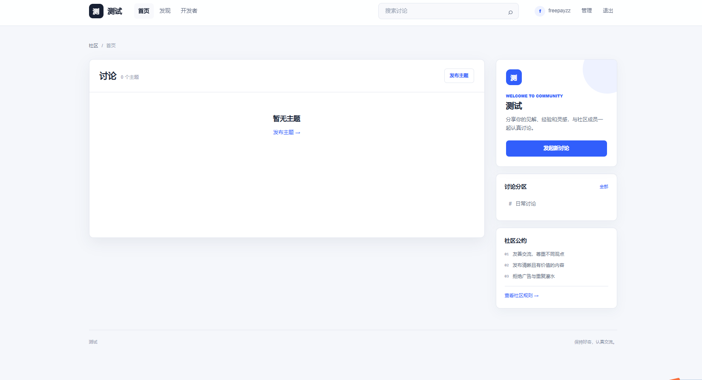
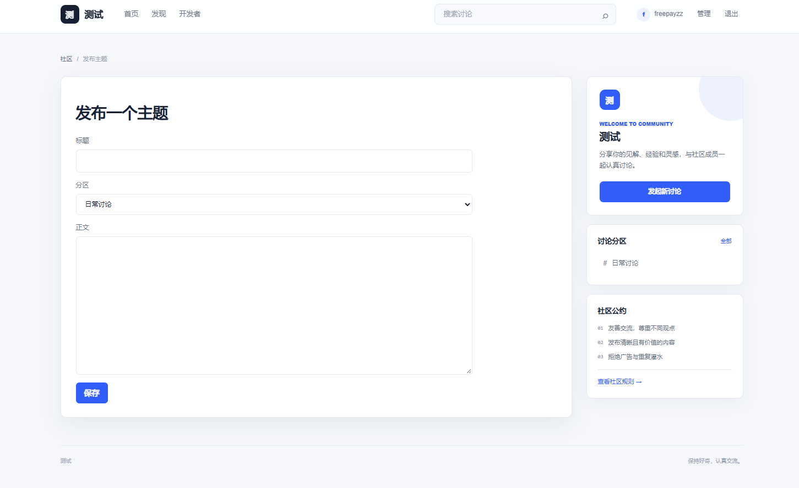
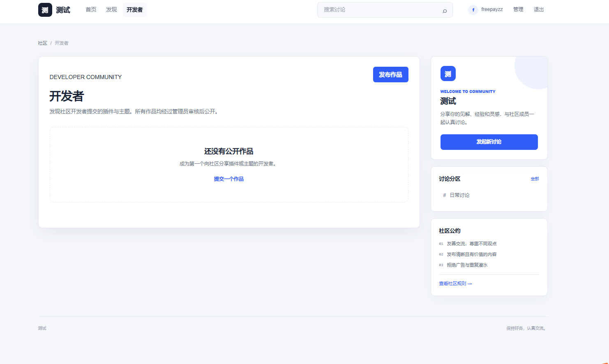

# LiteBBS

LiteBBS 是一个轻量 PHP + MySQL/ 论坛程序，提供主题讨论、分区管理、用户管理、内容审核、审计日志、模板和扩展管理功能。

## 截图







## 功能

- 论坛主题、回复、编辑与分页
- 可见/隐藏分区及排序管理
- 管理员后台：内容、用户、分区、模板、插件、扩展审核、审计与站点设置
- 登录会话、CSRF 防护、HTTPS 来源校验和操作审计
- Markdown 安全转义渲染
- 文件缓存与主题、分区、主题列表缓存失效
- 内部扩展市场的结构校验、签名清单和审核流程
- 固定 GitHub 官方仓库更新检查与确认式程序更新

## 环境要求

- PHP 8.0 或更高版本
- MySQL 8.0+ 或 MariaDB 10.6+
- PHP 扩展：`pdo_mysql`、`mbstring`
- 扩展市场与在线更新额外需要：`openssl`、`zip`、`curl`
- HTTPS Web 站点

## 安装

1. 将本项目文件上传到网站程序目录。
2. 确认 PHP Web 进程可写入程序目录中的 `private/`、`cache/` 和 `logs/`。
3. 在数据库面板创建空数据库和独立数据库用户，并授予建表所需权限。
4. 配置 Apache `.htaccess` 或参考 `nginx.conf.example` 配置 Nginx。
5. 使用 HTTPS 访问安装页面：

```text
https://example.com/install
```

如果程序部署在二级目录，例如 `/forum/`：

```text
https://example.com/forum/install
```

安装完成后，数据库配置和安装锁保存在程序目录下：

```text
private/config.php
private/install.lock
```

不要将 `private/` 暴露给 Web 访问。项目提供的 Apache 和 Nginx 规则已拒绝该目录。

## 数据库权限

应用数据库用户至少需要目标数据库的以下权限：

```sql
GRANT SELECT, INSERT, UPDATE, DELETE, CREATE, ALTER, INDEX, REFERENCES, DROP
ON `forum_db`.* TO 'forum_app'@'WEB_SERVER_IP';
```

`WEB_SERVER_IP` 必须是 MySQL/MariaDB 实际看到的 Web 服务器来源地址。IPv4、IPv6、`localhost` 和 `127.0.0.1` 属于不同的授权匹配项。

## 后台管理

管理员登录后访问：

```text
/admin
```

后台使用固定系统布局，不依赖前台主题。后台可管理：

- 主题与回复内容
- 用户角色和状态
- 讨论分区
- 模板和插件
- 扩展审核
- 官方更新检查
- 审计日志
- 站点设置

## 官方更新

程序更新源固定为：

```text
https://github.com/Lfreepayzz/LiteBBS/
```

在后台“扩展与更新”中可检查 `main` 分支的最新提交。发现新版本后，管理员需要确认更新；程序会备份发生变更的受管源码文件后再替换。

不会被后台更新覆盖的内容：

```text
private/
uploads/
cache/
logs/
数据库
```

更新仓库必须包含完整项目源码，至少包括：

```text
index.php
app/
database/
languages/
scripts/
templates/
```

## 安全与运维

- 生产环境必须启用 HTTPS。
- 安装完成前限制 `/install` 仅允许受信任的管理网络访问。
- `private/` 必须由 Web 服务器拒绝访问。
- 不要通过网页直接安装未经审查的 PHP 模板或插件。
- 更新前保留数据库和文件备份。
- 定期通过 CLI 执行清理脚本：


## 许可证

本项目采用 Apache License 2.0，详见 [LICENSE](LICENSE)。
